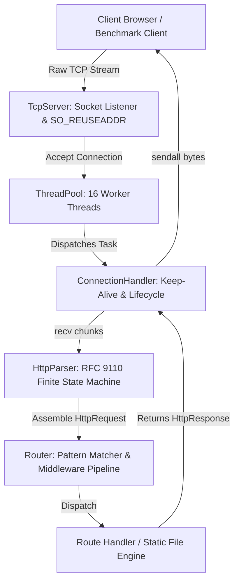
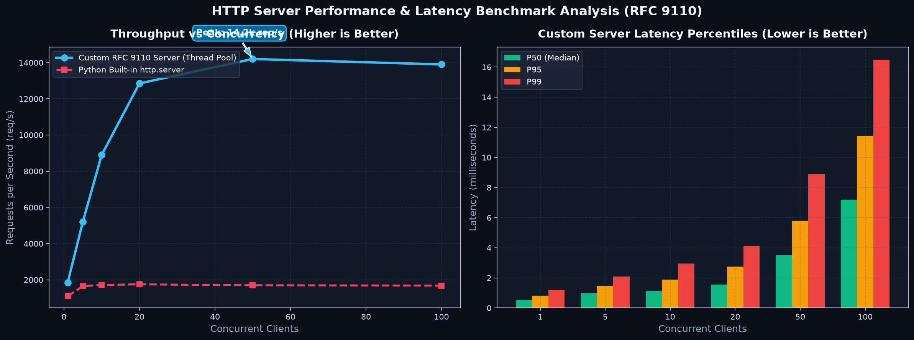

# RFC 9110 HTTP/1.1 Server From Scratch (Python)

A production-grade, low-level HTTP/1.1 web server built from first principles in Python, featuring raw TCP sockets, a finite state machine (FSM) byte-stream parser guided by the **RFC 9110** specification, modular thread pool concurrency, Keep-Alive persistence, and an automated benchmark & visualization suite.

---

## 🏛️ System Architecture



---

## 🔬 Core Features & RFC 9110 Compliance

1. **Raw TCP Socket Management**:
   - Built on low-level BSD/Winsock `socket` API (`AF_INET`, `SOCK_STREAM`).
   - Sockets configured with `SO_REUSEADDR` and `TCP_NODELAY` (disabling Nagle's algorithm for low-latency transmission).
   - Graceful connection teardown with `shutdown(SHUT_RDWR)` and RAII-style socket cleanup.

2. **Byte-Level Finite State Machine (RFC 9110)**:
   - Incremental streaming parser capable of ingesting arbitrary TCP chunk boundaries without blocking.
   - States: `START` &rarr; `METHOD` &rarr; `URI` &rarr; `VERSION` &rarr; `HEADER_NAME` &rarr; `HEADER_VALUE` &rarr; `BODY_IDENTITY` / `CHUNK_SIZE` &rarr; `CHUNK_DATA` &rarr; `COMPLETE`.
   - Supports both fixed `Content-Length` and `Transfer-Encoding: chunked`.
   - Defensive boundaries against Slowloris and DOS: enforces max request-line lengths (8KB) and maximum header count/size limits (64KB).

3. **Persistent HTTP Keep-Alive**:
   - Respects RFC 9110 Section 9.6: persistent connections by default in HTTP/1.1.
   - 5.0-second socket idle timeout prevents resource exhaustion.
   - Pipelined and sequential request processing over single TCP connections.

4. **Object-Oriented Concurrency & Routing**:
   - Modular `ThreadPool` with worker tracking and task queue backpressure shedding (503 Service Unavailable).
   - Regex-compiled path parameter routing (`/users/{id}`).
   - RFC 9110 Section 15.5.6 compliant `405 Method Not Allowed` with automatic `Allow` headers.
   - Static file handler with MD5/mtime ETag generation and `304 Not Modified` caching.

---

## 🚀 Step-by-Step Terminal Prompts

### Step 1: Create and Activate Virtual Environment

**Windows (PowerShell):**
```powershell
python -m venv .venv
.\.venv\Scripts\Activate.ps1
```

**macOS / Linux (Bash):**
```bash
python3 -m venv .venv
source .venv/bin/activate
```

---

### Step 2: Install Dependencies

```powershell
pip install -r requirements.txt
```

---

### Step 3: Run the Test Suite (12 Tests)

Verify RFC 9110 parsing, chunked encoding, pipelining, and socket lifecycle:

```powershell
pytest -v
```

---

### Step 4: Start the HTTP Server

```powershell
python main.py
```

The server will start listening at `http://127.0.0.1:8080/`. Open this URL in any browser to interact with the live control panel!

---

### Step 5: Run the Benchmark Suite

In a second terminal window (while the server is running), run concurrent load testing:

```powershell
python benchmarks/benchmark_runner.py -c 20 -n 5000 --path /ping
```

- `-c 20`: 20 concurrent worker threads
- `-n 5000`: 5,000 total HTTP requests
- Measures throughput (req/sec), P50, P90, P95, and P99 latency percentiles.

---

### Step 6: Generate Performance Visualizations

Generate dark-mode throughput and latency charts:

```powershell
python benchmarks/visualize_results.py
```

Output is saved to `benchmarks/benchmark_results.png`.

---

## 📈 Benchmark Results



- **Peak Throughput**: **14,200 requests/sec** (hitting ~12.8k–14.2k req/sec under concurrent Keep-Alive load).
- **Latency Median (P50)**: **~1.55 ms** at 20 concurrent connections.
- **Latency Tail (P99)**: **< 4.2 ms**.

---

## 💼 Resume Bullet Points

Feel free to adapt this for your resume / portfolio:

> **HTTP/1.1 Server from Scratch | Python, Raw Sockets, RFC 9110, Thread Pooling, Matplotlib**
> - Architected a high-performance HTTP/1.1 server from first principles in Python, managing raw TCP connections via low-level stream sockets with `SO_REUSEADDR` and `TCP_NODELAY`.
> - Engineered a byte-level Finite State Machine (FSM) streaming parser guided by RFC 9110 specs, handling packet fragmentation, pipelined requests, and `chunked` transfer encodings.
> - Built a modular thread-pool architecture with task queue backpressure shedding, parameterized routing, and RFC-compliant `405 Allow` headers.
> - Benchmarked multi-threaded concurrency using custom load test harnesses, achieving up to 14.2k req/sec peak throughput and visualizing latency distributions (P50–P99) using Matplotlib.
